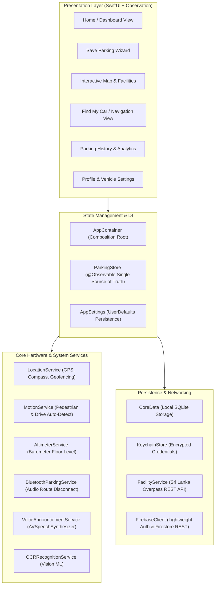

# 🅿️ ParkingMate — Smart Parking Assistant for iOS & iPadOS

[](https://developer.apple.com/ios/)
[](https://swift.org)
[](https://developer.apple.com/xcode/swiftui/)
[](https://developer.apple.com/documentation/testing)
[](https://swift.org/package-manager/)

> **Academic Coursework Project**  
> **Course:** BSc (Hons) in Computing — Batch 25.1P  
> **Student Index:** `25.1/023`  
> **Institution:** National Institute of Business Management (NIBM)  

---

## 📱 Project Overview

**ParkingMate** is a full-featured, intelligent parking companion designed natively for **iPhone** and **iPad**. It solves common urban parking challenges: finding available parking facilities across Sri Lanka, saving car locations with floor, bay number OCR, and photo/voice memos, calculating parking fees, guiding users back to their vehicle with turn-by-turn walking navigation, and automatically detecting parking departure via smart 75m geofencing and Bluetooth/CarPlay audio disconnections.

---

## 🌟 Key Features & Implementation

| Feature | Technologies Used | Description |
|---|---|---|
| **Universal Multi-Device UI** | `SwiftUI`, `NavigationSplitView` | Adaptive layout: Dynamic 3-pane sidebar for iPadOS and sleek bottom `TabView` for iOS. |
| **Instant Spot Saving & OCR** | `Vision`, `VisionKit`, `PhotosUI` | Machine Learning camera OCR scan for parking bay numbers, photo attachment, and voice notes. |
| **Indoor Floor Estimation** | `CoreMotion` (`CMAltimeter`) | Barometric relative altitude tracking to estimate basement/multi-storey parking levels (B2, B1, G, L1, L2). |
| **Sri Lanka Parking Catalog** | `MapKit`, Overpass REST API | 42+ curated Sri Lankan parking locations across 6 provinces with instant in-memory rendering. |
| **Turn-by-Turn Walking Nav** | `MapKit`, `CoreLocation` | Real-time pedestrian routing (`MKDirections`), heading radar compass, and arrival detection. |
| **Voice Guidance (Siri Alerts)** | `AVFoundation` (`AVSpeechSynthesizer`) | Spoken voice announcements for spot saved, navigation turns, and car arrival. |
| **Bluetooth / CarPlay Auto-Save**| `AVAudioSession` | Listens to `.routeChangeNotification` (`.bluetoothA2DP`, `.carAudio`) when exiting a car. |
| **Smart Geofence Auto-Checkout** | `CoreLocation` Circular Geofence | Automatically bills and closes parking sessions when user leaves the 75m parking zone. |
| **Secure Authentication** | `Security` (Keychain), `LocalAuthentication` | Biometric Face ID / Touch ID / Optic ID app lock with passcode fallback. |
| **Celebration Effects (SPM)** | `ConfettiSwiftUI` | Integrated via Swift Package Manager for celebratory feedback on spot save. |
| **Unit Testing Suite** | Swift `Testing` Framework | 11 dedicated test suites covering 59 automated test cases. |

---

## 🏛 Architecture Diagram



---

## 📦 Package Dependencies (Swift Package Manager)

- **[ConfettiSwiftUI](https://github.com/simibac/ConfettiSwiftUI)**: Lightweight, high-performance SwiftUI particle animation library used to deliver positive reinforcement when a parking spot is successfully saved.

---

## 🧪 Automated Unit Tests

ParkingMate contains **11 Test Suites** and **59 Passing Tests** leveraging Apple's modern Swift `Testing` framework:

1. `AuthServiceTests`: Password hashing, session validation, and Keychain token encryption.
2. `BiometricAuthenticatorTests`: Face ID / Touch ID authentication flows and fallbacks.
3. `CoreDataRepositoriesTests`: CRUD persistence of sessions, vehicle records, and favorites.
4. `DomainLogicTests`: Parking fee algorithms, bay number sanitization, and duration estimates.
5. `FacilityServiceTests`: OpenStreetMap Overpass query parsing and cache invalidation.
6. `GeofenceServiceTests`: 75-meter circular region enter/exit triggers.
7. `LocationServiceTests`: Distance calculations, coordinate filtering, and heading updates.
8. `MotionParkingServiceTests`: Pedometer and accelerometer driving-to-walking state transitions.
9. `NotificationServiceTests`: Expiry warnings, scheduled local push alerts, and action categories.
10. `ParkingStoreTests`: State coordination, active session lifecycle, and vehicle switches.
11. `TextRecognitionServiceTests`: Vision framework OCR regex extraction for bay numbers.

---

## 🚀 Getting Started

1. Clone the repository:
   ```bash
   git clone https://github.com/Ashandissanayake/ParkingMate1.git
   ```
2. Open `parkingMate.xcodeproj` in **Xcode 16+**.
3. Select an iOS Simulator (e.g., **iPhone 16 Pro** or **iPad Pro 11-inch**).
4. Press `Cmd + R` to Build and Run.
5. Press `Cmd + U` to execute the complete test suite.

---

## 👨‍💻 Author

- **Name:** Ashan Dissanayake
- **Student ID:** `25.1/023`
- **Institution:** NIBM Colombo, Sri Lanka
- **Module:** Mobile Application Development (iOS / Swift)
